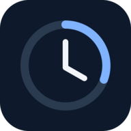
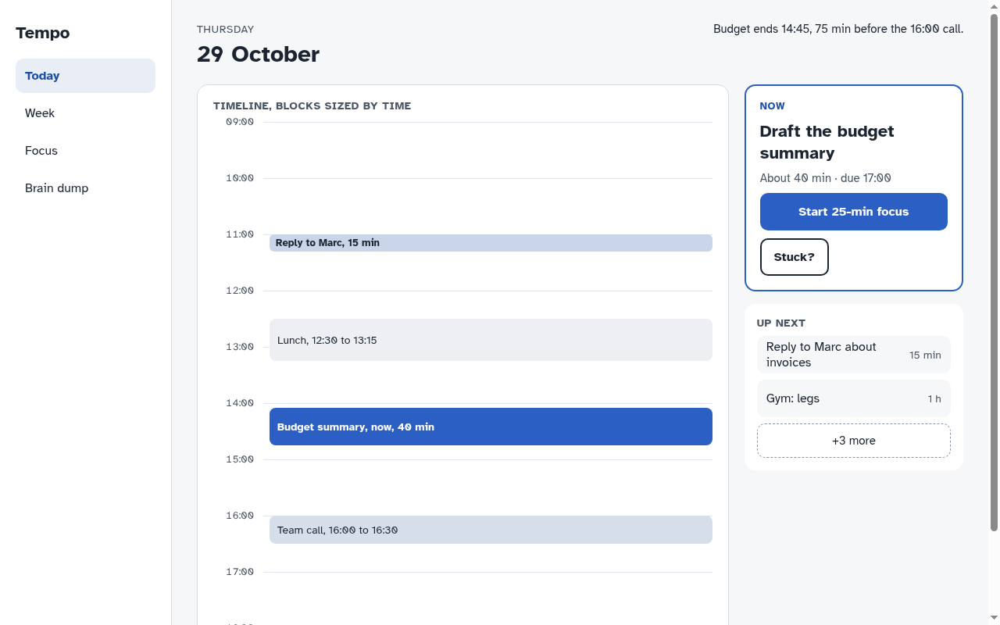
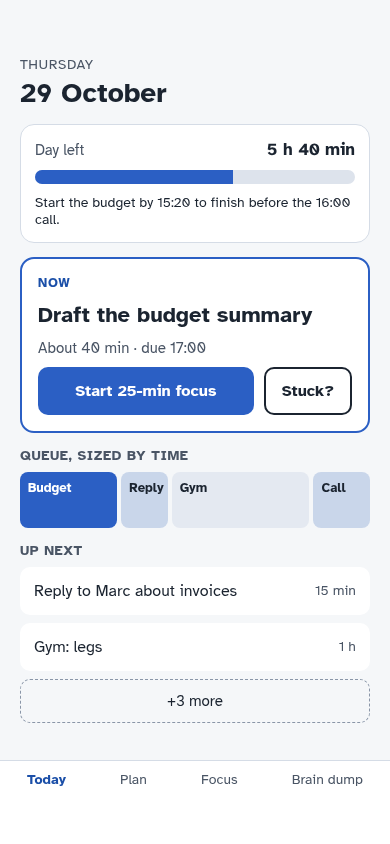

<p align="center"></p>

<p align="center"></p>

# Tempo Planner

A calm, local-first planning PWA for Android and Windows 11, designed around making time visible and getting started with one task at a time.

## Design previews

These screenshots were captured from an early prototype on 29 October 2026. They use example data and do not verify the current build or its appearance on target devices.

| Desktop preview | Mobile preview |
| --- | --- |
|  |  |


Tempo is being delivered as a Progressive Web App (PWA) for Android and Windows 11. This is the settled delivery decision; native Android and Windows packages are out of scope for this delivery. The runnable foundation uses the six supplied screen templates from the compressed source, adds local task/capture/focus flows, and stores changes in the current browser's `localStorage`. The original supplied HTML remains the exact visual authority. Rendered visual fidelity has not been verified.

## Run locally

Requires Node.js 20 or newer. From this folder:

```sh
npm start
```

Open the printed local address in a current browser. The app includes a web app manifest and a service worker that precaches the app shell for offline loading. Serve it over HTTPS in deployment; browsers generally permit localhost for development. Installability and behavior depend on the browser and operating system. This has not been verified on Android or Windows 11. It does not produce an Android APK or Windows installer.

Run the lightweight model tests with:

```sh
npm test
```

## Implemented in this first slice

- The four 390 × 844 phone reference screens and two 1280 × 800 desktop reference screens, extracted from the approved HTML and kept as standalone templates.
- Local task creation and editing, explicit scheduling, completion, and a mobile Plan adaptation.
- Brain Dump drafts save locally; users review and edit split items before accepting them into Later, with the original capture retained.
- Linked subtasks with a manually entered draft, review, editing, reordering, removal and undo. Automatic generation is not implemented.
- Optional on-device voice transcription in Brain Dump using a multilingual Whisper Tiny model. The browser downloads approximately 42 MB on first setup; microphone audio is processed on-device and is not uploaded to a recognition service. The text becomes a normal draft and can sync if you enable sync. The browser language selects the speech language, falling back to English for unsupported locales.
- A pause/resume focus timer that recalculates after backgrounding or reopening.
- An optional, adjustable pre-departure reminder, default lead time of two minutes. Reminder timers and browser notifications are handled by the open page; they are not dependable after the page closes or the browser/OS suspends it.
- Flexible weekly recurrence with a time zone, completion per window and non-punitive missed-window history. Transition warnings, optional repeated reminders, hyperfocus check-ins and low-stimulation appearance have open-page implementations. Alert batching and background delivery are not implemented; other controls remain previews.
- Account sign-in, automatic local change queue, conflict history and recovery against a self-hosted sync server.
- Local JSON backup export and validated backup import. Import replaces this browser's saved state only after confirmation; it is a manual transfer path, not sync.

The initial task names in the reference are examples. Once real data is saved, unchanged examples are removed. The desktop Today and live Week timelines use scheduled task data. Their rendering, interactions and visual fidelity have not been verified in a browser.

## Known gaps

- **Cross-device sync and accounts:** client and server foundations are implemented and tested together using simulated clients. No HTTPS service is deployed, and real device sync is unverified. The server binds to loopback by default; a shared, securely configured HTTPS host is required. See [server/README.md](server/README.md) for security and operational limitations. Export/import is a separate manual backup path.
- **PWA platform verification:** installability, offline behavior and runtime behavior have not been verified on actual Android or Windows 11 targets. Browser support and installation flows vary by platform.
- **Background notifications:** not implemented. A timer in an open page cannot guarantee delivery after the page closes, the browser/OS suspends it, or notification permission is denied.
- **Voice verification:** the model was exercised offline with a public audio sample using Node CPU. Actual browser WASM, microphone behavior and accuracy have not been verified on Android or Windows 11. Model download, caching and storage may vary by browser.
- **Automatic task decomposition, calendar integration, other recurrence patterns, multiple-device focus ownership, screen-reader/device audit, and user research:** not implemented or validated.

The original HTML and its bundled Atkinson Hyperlegible font assets are the source for the reference templates. The Google Fonts license notice in the supplied source applies to those font files.

## Privacy and security

Task and capture data are stored in the browser. When sync is enabled, your data is sent to the sync server you configure; the included server's storage is not encrypted at rest. Production use requires HTTPS, secure storage and backup, and a recovery plan. Background reminders are not guaranteed. Do not enter important personal information until the server and recovery setup have been reviewed. See [server/README.md](server/README.md).

## Licensing and credits

The bundled Atkinson Hyperlegible fonts are covered by the [SIL Open Font License](src/assets/fonts/OFL.txt). The original supplied design is the visual reference. A project-wide source code license has not yet been selected. The clock icon is included in `src/assets/`; the hero banner is an AI-generated illustration.

The on-device speech runtime is vendored from Transformers.js under its [Apache 2.0 license](src/vendor/transformers/LICENSE). Model weights are separately downloaded from a pinned Hugging Face model revision.

The shipped screen templates are included in the repository. `scripts/extract-reference.py` is an optional developer utility that needs the original supplied HTML attachment, which is intentionally not included in this repository.
